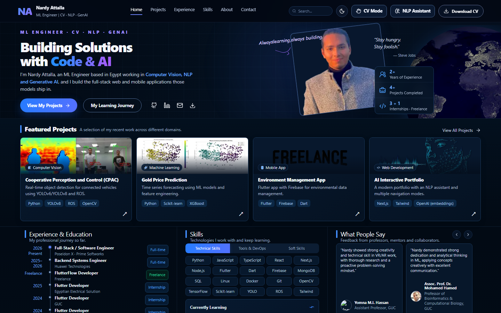
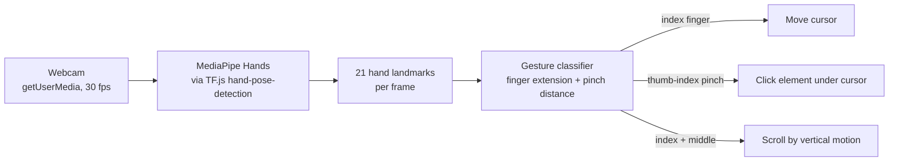
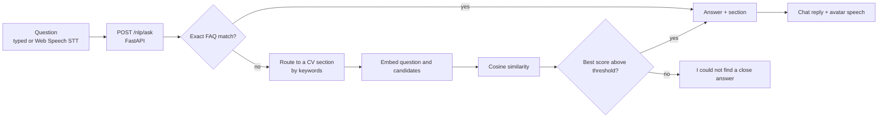

# AI Interactive Portfolio

A portfolio you can browse with your hand or by asking it questions. The site runs real-time hand tracking in the browser to drive a virtual cursor, and an NLP assistant that answers questions about my work by retrieving the closest answer from a knowledge base.

**[▶ Live site: ai-interactive-portfolio.vercel.app](https://ai-interactive-portfolio.vercel.app)**

[](https://ai-interactive-portfolio.vercel.app)


[](./LICENSE)



## What it does

- **Three ways in.** Browse the site normally, switch on **CV Mode** and control it with hand gestures through your webcam, or open the **NLP Assistant** and ask about projects, skills and experience by typing or speaking.
- **Gesture control in the browser.** Camera frames never leave the device. Hand landmarks are detected client-side and turned into cursor moves, clicks and scrolls.
- **Question answering over my CV.** The assistant matches a question against a curated set of answers and returns the closest one, plus the portfolio section it belongs to.

Demo videos: [web and design](https://github.com/user-attachments/assets/9e2b8b95-c876-4b46-bce2-ec0e4512e0ac) · [gesture navigation](https://github.com/user-attachments/assets/a477904c-0fef-4f0e-9825-44cc158ce648) · [NLP assistant and avatar](https://github.com/user-attachments/assets/5b2456c6-d6b0-4a0d-95e9-eff031c72152)

## How the ML works

### Gesture navigation



1. **Camera.** `getUserMedia` streams the front camera into a hidden `<video>` element.
2. **Hand detection.** `@tensorflow-models/hand-pose-detection` runs the MediaPipe Hands model (`full`, one hand) on every animation frame and returns 21 keypoints per hand.
3. **Landmarks to features.** A finger counts as *extended* when its tip is more than 1.15× farther from the knuckle (MCP) than its middle joint (PIP), which makes the test independent of hand size and distance from the camera. Pinch is the thumb-tip to index-tip distance.
4. **Gesture classifier.** A small rule-based classifier on those features: index finger only moves the cursor, index and middle together scroll, and a thumb-index pinch clicks (with a 700 ms debounce so one pinch is one click).
5. **Navigation.** The cursor is mapped from video to viewport coordinates; a click dispatches a real DOM `click` on the element under the cursor, so every link and button works without special wiring.

Source: [`portfolio/components/cv1.tsx`](portfolio/components/cv1.tsx). An earlier server-side version (OpenCV + MediaPipe over a WebSocket) is kept in [`backend/CV.py`](backend/CV.py).

### NLP assistant



1. **Query.** The browser captures the question as text or through the Web Speech API and sends it to the backend ([`portfolio/lib/assistant.ts`](portfolio/lib/assistant.ts)).
2. **Retrieval.** [`backend/NLP.py`](backend/NLP.py) checks exact FAQ matches first, then narrows the candidates to a CV section (skills, projects, experience, education and so on) from keywords in the question.
3. **Embedding and nearest answer.** The question and each candidate answer are turned into vectors and scored by cosine similarity. The best answer above a 0.12 threshold is returned; below it, the assistant says it doesn't know instead of guessing.
4. **Response.** The reply and the matched section go back to the UI, which shows it in the chat and speaks it through the avatar.

**Model choice.** The retrieval was designed around SBERT sentence embeddings (`all-MiniLM-L6-v2`, via `sentence-transformers`). The model and its PyTorch runtime come to several GB, so the free Vercel deployment swaps in a lightweight bag-of-words vectoriser with the same cosine-similarity retrieval. The SBERT stack is documented at the top of `NLP.py` and drops back in where `_similarity` is defined.

## Stack

| Area | Tools |
|---|---|
| Computer vision | MediaPipe Hands, TensorFlow.js (`hand-pose-detection`, `tfjs-core`) |
| NLP | Retrieval QA with cosine similarity; SBERT (`all-MiniLM-L6-v2`) in the full version; Web Speech API for speech in and out |
| Frontend | Next.js 15, React 19, TypeScript, Tailwind CSS, Three.js / React Three Fiber (avatar) |
| Backend | Python, FastAPI, Uvicorn, Docker, Render / Vercel |

## Run it yourself

**Web app**

```bash
git clone https://github.com/Nardy11/AI-Interactive-Portfolio.git
cd AI-Interactive-Portfolio/portfolio
cp .env.example .env.local    # NEXT_PUBLIC_API_URL=http://localhost:8000 for a local backend
npm ci
npm run dev                   # http://localhost:3000
```

Camera and microphone features need a secure context (`localhost` or HTTPS).

**Backend**

```bash
cd backend
pip install -r requirements.txt
uvicorn main:app --port 8000  # POST /nlp/ask, GET /health
```

Or with Docker: `docker build -t portfolio-backend backend && docker run -p 8000:8000 portfolio-backend`. Set `FRONTEND_URLS` to the allowed CORS origins (comma-separated).

## Limitations

- Gesture tracking depends on lighting, camera quality and the visitor's hardware.
- Browser speech recognition and synthesis vary between browsers.
- The assistant answers only from its curated knowledge base; it does not generate free text.

## Licence

MIT, see [LICENSE](./LICENSE).
